# Sub-µA Output-Capacitor-Less LDO with Sub-Threshold Slew-Rate Enhancement (180 nm CMOS)

Transistor-level design, simulation and stability debugging of an ultra-low-quiescent-current **output-capacitor-less LDO (OCL-LDO)** in **180 nm CMOS**, using **Cadence Virtuoso (ADE L) and Spectre**.

The circuit reproduces the architecture of Zhang *et al.*, *"A 640 nA I<sub>Q</sub> Output-Capacitor-Less LDO Regulator with Sub-Threshold Slew-Rate Enhancement for NB-IoT Applications"*, Micromachines 2024 ([doi:10.3390/mi15081019](https://doi.org/10.3390/mi15081019)). It serves as the baseline for a final-year project that will replace the paper's slew-rate-enhancement block with a new one.

> **Status: work in progress.** The baseline is functional, and a stability problem in the SRE loop has been found and fixed at the typical corner. Robustness work is still open: the bias regions at light load, a stability sweep across load, process corners and temperature. See [Current status and next steps](#current-status-and-next-steps).

---

## Highlights

| | |
|---|---|
| **Supply / output** | V<sub>IN</sub> = 1.2 V, V<sub>OUT</sub> = 1.0 V (200 mV dropout) |
| **Load range** | 1 µA – 100 mA |
| **Minimum quiescent current** | **1.03 µA** (simulated, at 1 µA load) |
| **Peak current efficiency** | **99.935 %** at 100 mA (paper: 99.94 %) |
| **Main-loop stability** (100 µA load) | PM = 46.9°, GM = 13.1 dB, UGF = 599 kHz |
| **Load-step undershoot** (100 µA → 100 mA, 500 ns) | ≈ 710 mV without SRE → **≈ 310 mV with SRE** |
| **Key debugging result** | Traced a sustained 1.5 MHz oscillation to a second feedback loop formed by the SRE, and removed it by re-biasing the SRE |

---

## Architecture

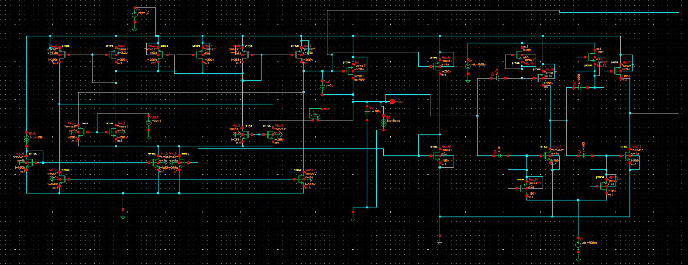
*Cadence schematic (before the SRE bias fix, BIAS2 = 300 mV).*

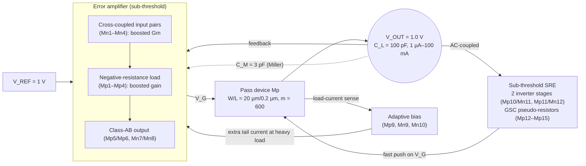

| Block | Purpose |
|---|---|
| **Error amplifier** | Cross-coupled input stage raises the effective transconductance and a negative-resistance load raises the gain, both at nA bias currents. I<sub>BIAS</sub> = 500 nA. |
| **Pass transistor Mp** | Large PMOS (m = 600) that supplies up to 100 mA at 200 mV dropout. Its gate capacitance is the main slew-rate bottleneck. |
| **Adaptive bias** | Mirrors a small fraction of the load current into the EA, so the amplifier speeds up only when the load is heavy. Quiescent current rises from 1 µA to 65 µA across the load range. |
| **Slew-rate enhancement (SRE)** | Senses fast V<sub>OUT</sub> changes through capacitors and drives V<sub>G</sub> hard through two sub-threshold inverters. Gate-source-connected (GSC) PMOS devices act as GΩ pseudo-resistors that hold the inverter gates at BIAS1/BIAS2. Its idle current is only about 16 nA. |

A beginner-friendly explanation of the SRE is in **[docs/sre-explained.md](docs/sre-explained.md)**.

---

## Results

All results are pre-layout Spectre simulations at the typical corner and 27 °C, with V<sub>IN</sub> = 1.2 V. Values marked ≈ were read from waveform plots; the others are exact simulator outputs.

### 1. DC operating point

| Load | V<sub>OUT</sub> | V<sub>G</sub> (Mp gate) |
|---|---|---|
| 100 µA | 999.24 mV | 894.5 mV (Mp in sub-threshold) |
| 100 mA | 994.54 mV | 506.4 mV |

Load regulation from these two points is ≈ 47 µV/mA (paper: 7.6 µV/mA). The difference points to lower loop gain than the published design, which is listed under next steps.

<p>
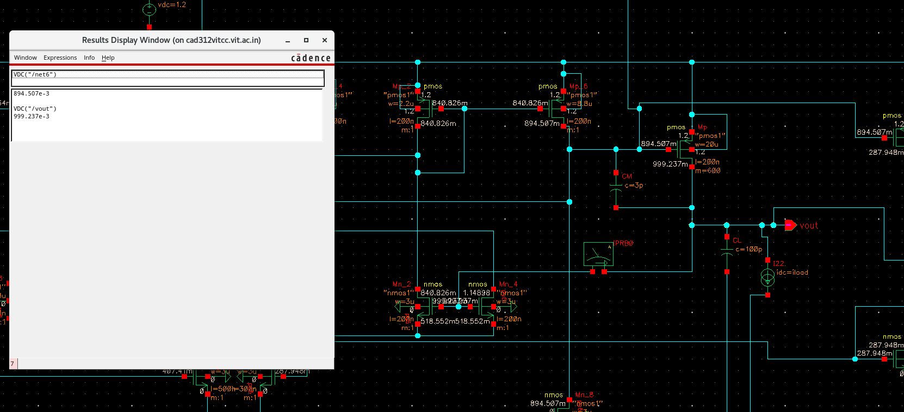
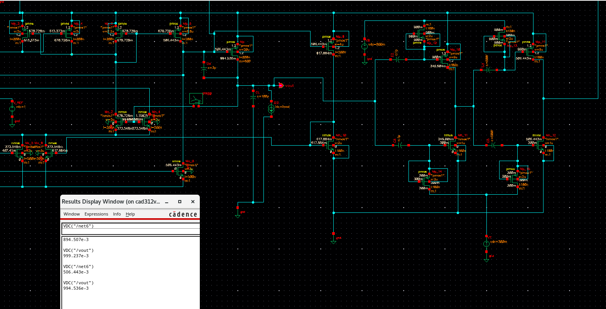
</p>

### 2. Quiescent current vs load

| I<sub>LOAD</sub> | I<sub>Q</sub> (this work) | I<sub>Q</sub> (paper, measured) | Current efficiency |
|---|---|---|---|
| 1 µA | **1.03 µA** | 0.64 µA | 49.3 % |
| 10 µA | 1.03 µA | 0.70 µA | 90.7 % |
| 100 µA | 1.08 µA | 0.87 µA | 98.9 % |
| 1 mA | 1.62 µA | 1.86 µA | 99.84 % |
| 10 mA | 7.19 µA | 6.8 µA | 99.93 % |
| 100 mA | 65.0 µA | 61.2 µA | **99.935 %** |

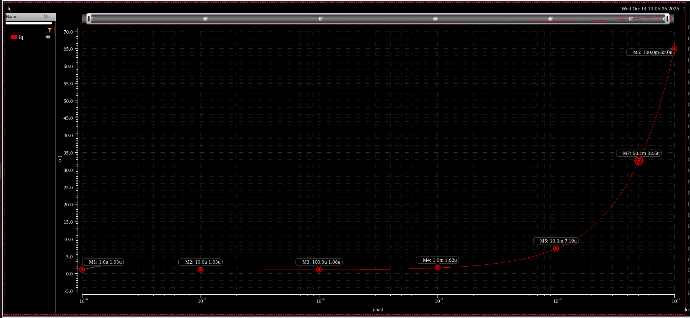

**Where the light-load current goes** (DC operating point at 1 µA load):

| Branch | Current | Share |
|---|---|---|
| Bias reference I<sub>BIAS</sub> | 500 nA | ≈ 49 % |
| EA tail (Mn5) | 510 nA | ≈ 50 % |
| SRE inverters (Mn11 + Mn12) | ≈ 16 nA | ≈ 1.6 % |
| Adaptive bias (Mn9 + Mn10) | ≈ 0.5 nA | ≈ 0 % |

So I<sub>Q</sub> ≈ 2 × I<sub>BIAS</sub>, and I<sub>BIAS</sub> is the main lever for reaching the paper's 640 nA. The SRE adds almost nothing.

### 3. Loop stability (stb analysis, 100 µA load)

| Loop | Probe | Phase margin | Gain margin |
|---|---|---|---|
| Main loop, SRE disconnected | IPRB0 | **46.9°** @ 599 kHz | **13.1 dB** @ 1.53 MHz |
| SRE loop alone, BIAS2 = 300 mV | IPRB1 | 34.8° @ 763 kHz | **4.4 dB** @ 970 kHz |

<p>
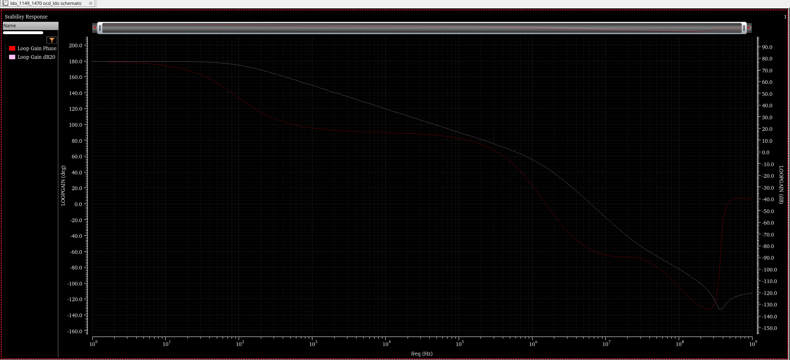
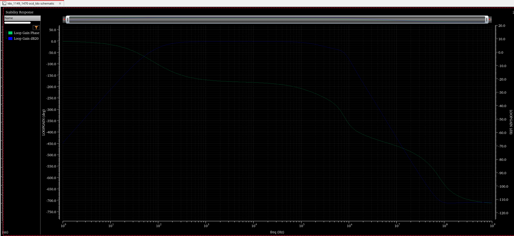
</p>

*Left: main loop with the SRE removed, showing a clean single-pole roll-off. Right: the SRE loop alone, with about +8 dB of mid-band gain and only 4.4 dB of gain margin.*

### 4. Load transient (100 µA ↔ 100 mA, 500 ns edges)

| Configuration | Undershoot | Overshoot | Settles? |
|---|---|---|---|
| No SRE | ≈ 710 mV | ≈ 200 mV (rail-limited) | Yes, in ≈ 1 µs / ≈ 3 µs |
| SRE, BIAS2 = 300 mV (original) | ≈ 265 mV | rail-to-rail ringing | **No: sustained 1.5 MHz oscillation** |
| **SRE, BIAS2 = 240 mV (fixed)** | **≈ 310 mV** | ≈ 200 mV (rail-limited) | **Yes**, in ≈ 1 µs / ≈ 4 µs |
| *Paper (measured)* | *201 mV* | *197 mV* | *1.8 µs / 1.7 µs* |

<p>
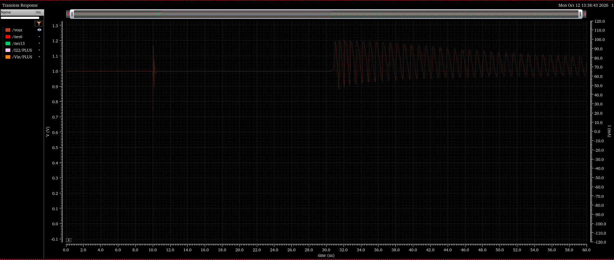
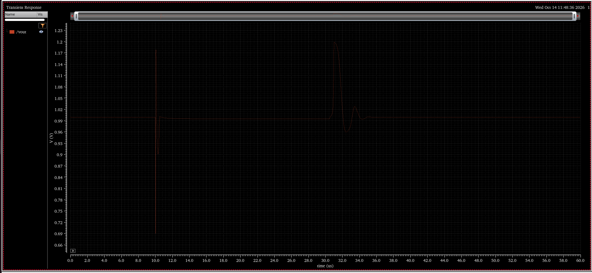
</p>

*Left: original SRE bias, oscillating after the load step-down. Right: after the bias fix, V<sub>OUT</sub> settles after both edges.*

---

## Debugging story: an oscillation caused by the SRE

The most instructive part of this project was finding why the regulator oscillated.

1. **Symptom.** With the SRE connected, V<sub>OUT</sub> oscillated indefinitely at ≈ 1.5 MHz after the load stepped from 100 mA down to 100 µA. The heavy-load step settled normally.
2. **Main loop on its own.** Disconnecting the SRE gave a clean loop: PM = 46.9°, GM = 13.1 dB. Its −180° frequency was **1.53 MHz**, which matched the oscillation frequency.
3. **Hidden second loop.** The stb probe only breaks the EA feedback path. The SRE forms its own loop, V<sub>OUT</sub> → coupling capacitors → two inverters → V<sub>G</sub> → Mp → V<sub>OUT</sub>. A second probe in the SRE output showed it had **+8 dB of mid-band gain and only 4.4 dB of gain margin**.
4. **Why it oscillated.** Near 1.5 MHz the SRE added enough gain to use up the main loop's 13 dB margin. The SRE runs in sub-threshold, so its gain grows exponentially during a large swing, which made the small-signal margin disappear completely in the transient. Light load is the worst case because the pass device's gain, and the main loop's phase margin, are lowest there.
5. **Fix.** The SRE inverter gate bias was parameterised (BIAS2 = v<sub>b2</sub>, BIAS1 = 1.2 V − v<sub>b2</sub>) and swept in transient, measuring the peak-to-peak V<sub>OUT</sub> over the last 10 µs:

   | v<sub>b2</sub> | 150–260 mV | 265 mV | 270 mV | 300 mV |
   |---|---|---|---|---|
   | Residual oscillation | ≈ 0 | ≈ 1 mV | ≈ 72 mV | ≈ 155 mV |
   | Undershoot | 370 → 295 mV | 291 mV | 288 mV | 265 mV |

   The stability boundary is at about 265–270 mV. **v<sub>b2</sub> = 240 mV** was chosen to leave about 25 mV of margin for process and temperature spread, at a cost of only about 45 mV of extra undershoot.

<p>
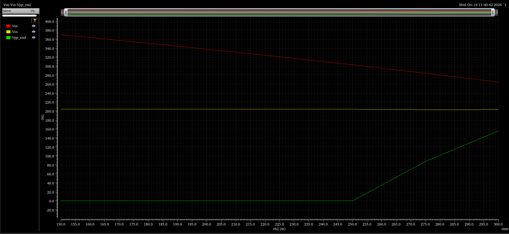
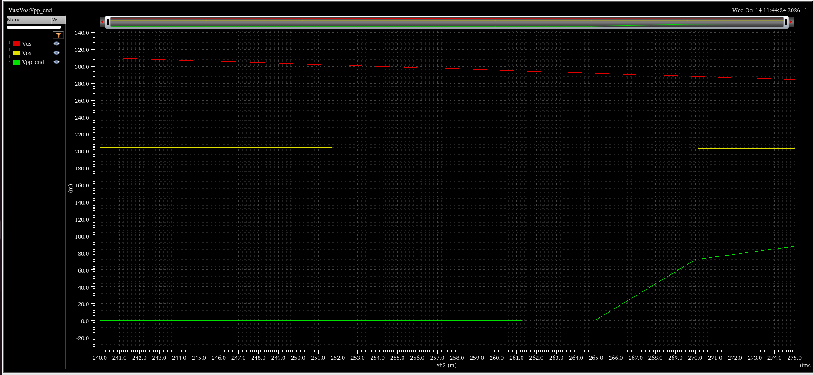
</p>

*Red: undershoot. Yellow: overshoot. Green: residual oscillation, plotted against SRE bias.*

The general lesson: **any auxiliary circuit that feeds back to the same node creates a new loop, and that loop needs its own stability check.** The full investigation is in [docs/stability-investigation.md](docs/stability-investigation.md).

---

## Current status and next steps

Done:
- [x] Full transistor-level schematic of EA, adaptive bias, SRE and pass device
- [x] DC operating point, quiescent current vs load, current efficiency
- [x] Main-loop and SRE-loop stability analysis
- [x] Root-caused and fixed the SRE-induced oscillation (typical corner)

Open:
- [ ] **Bias regions.** At light load several devices sit in cutoff, including the EA class-AB output branch (Mn7/Mn8, ≈ 5 pA). The project guide requires every active device to stay in saturation across the full load range. Re-biasing this branch is the next design task.
- [ ] **Stability across the full load range** (1 µA – 100 mA), not only at 100 µA
- [ ] Process corners (NN/FF/SS/FS/SF) and temperature (−40 °C to 125 °C)
- [ ] Load regulation (full DC sweep), line regulation, PSRR
- [ ] Reduce I<sub>BIAS</sub> toward the paper's 640 nA quiescent current, while checking phase margin
- [ ] Replace the paper's SRE with the new SRE topology provided by the project guide, and compare

---

## Tools and setup

- **Cadence Virtuoso** schematic editor, **ADE L**, **Spectre** (dc, stb, tran, parametric analysis)
- 180 nm CMOS models (Cadence generic PDK, gpdk180)
- Analyses used: DC operating point and sweeps, `stb` loop-gain with `iprobe` (two probes for the two loops), transient with `ipulse` load steps, and parametric sweeps with calculator expressions

Example calculator expressions used for automated measurement:

```text
Undershoot   : value(VT("/vout") 9.9u) - ymin(clip(VT("/vout") 10u 30u))
Overshoot    : ymax(clip(VT("/vout") 30.5u 60u)) - value(VT("/vout") 30.4u)
Oscillation  : ymax(clip(VT("/vout") 50u 60u)) - ymin(clip(VT("/vout") 50u 60u))
Iq vs load   : abs(IS("/Vin/PLUS")) - xval(IS("/Vin/PLUS"))
```

## Repository layout

```
├── README.md
├── docs/
│   ├── sre-explained.md            # How the slew-rate enhancement works, step by step
│   └── stability-investigation.md  # Full record of the oscillation debugging
└── images/
    ├── schematic/                  # Cadence schematic
    ├── dc/                         # DC operating points
    ├── stability/                  # stb loop-gain plots and stability summaries
    ├── transient/                  # Load-step waveforms and SRE bias sweeps
    └── quiescent-current/          # Iq vs load
```

## Team and acknowledgement

- **Shravan Adash M**, B.Tech ECE, VIT Chennai
- **Preetish**, B.Tech ECE, VIT Chennai
- Project guide: **Dr. Manikandan P**, School of Electronics Engineering (SENSE), VIT Chennai

The circuit architecture is from Zhang, Cai, Chen and Yin, *Micromachines* 2024, 15, 1019. This repository contains our own implementation, simulations and analysis; the paper itself is not redistributed here.
