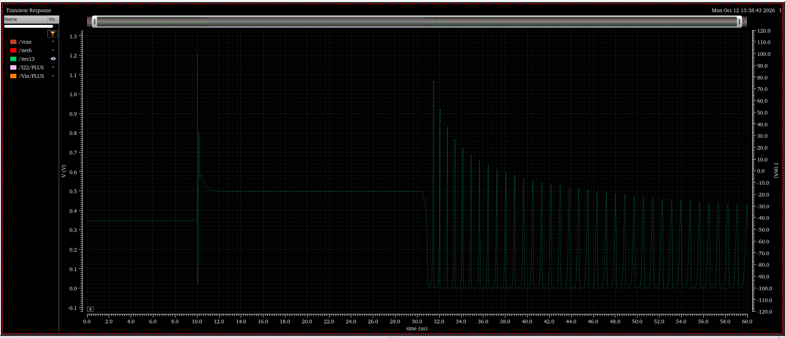
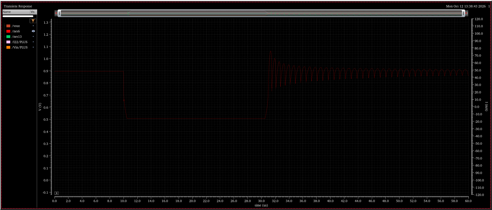
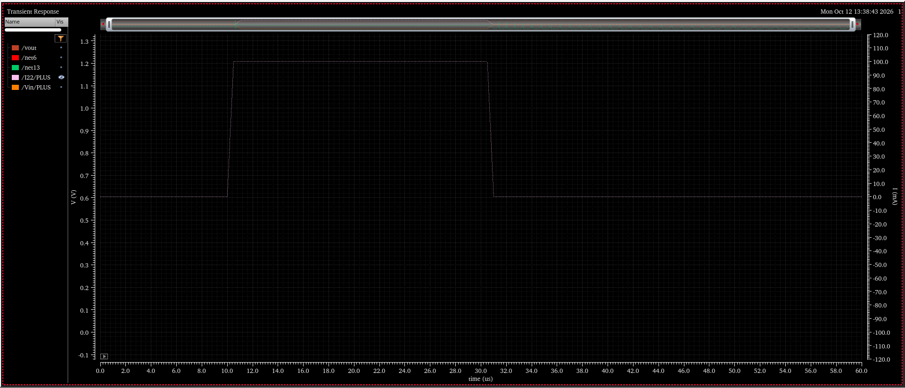
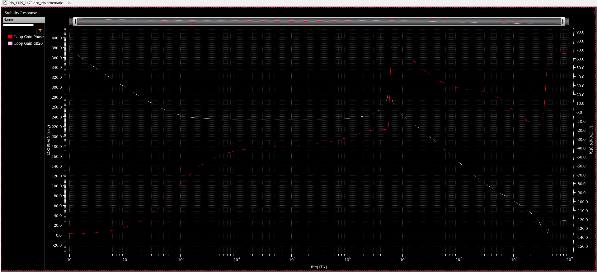
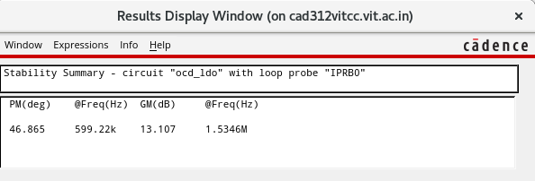
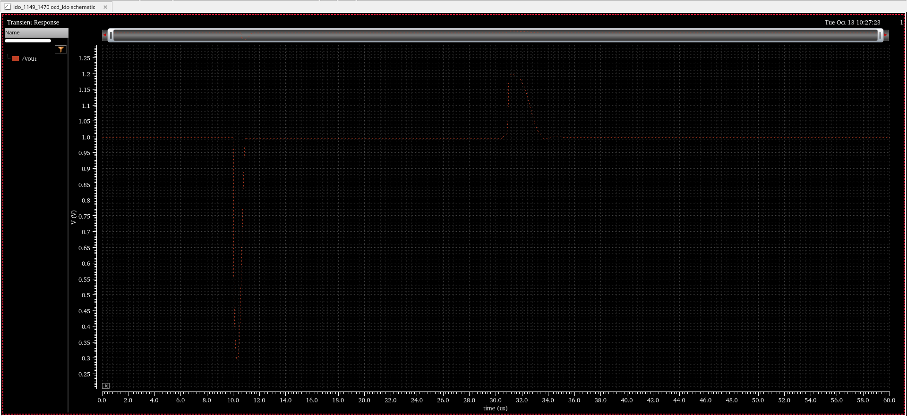
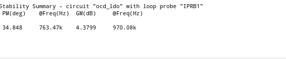

# Stability investigation: the SRE-induced oscillation

[← Back to README](../README.md)

Conditions for every run: VIN = 1.2 V, VOUT = 1.0 V, CL = 100 pF, CM = 3 pF, typical models, 27 °C.

## Step 1: The symptom (transient)

Load step 100 µA ↔ 100 mA with 500 ns edges (`ipulse`: delay 10 µs, width 20 µs).

| Event | Result |
|---|---|
| 10 µs, load rises | Undershoot ≈ 265 mV, brief ringing, then settles |
| 30.5 µs, load falls | **Sustained oscillation ≈ 0.88–1.2 V at ≈ 1.5 MHz, still present at 60 µs** |

The SRE output node fired rail to rail on every cycle.

## Step 2: Loop gain with the SRE connected

The stb loop gain through the main-loop probe (IPRB0) at 100 µA was abnormal. It showed a flat region of about −7 dB from 300 Hz to 100 kHz, and a **sharp resonant peak of about +23 dB near 570 kHz** with a fast phase jump, crossing 0 dB several times. That is the signature of a lightly damped complex pole pair.

## Step 3: Main loop without the SRE

With the SRE output disconnected from VG, the loop gain became a textbook Miller-compensated response: about 77 dB DC gain, a dominant pole near 100 Hz and a single 0 dB crossing.

| PM | UGF | GM | −180° frequency |
|---|---|---|---|
| 46.9° | 599 kHz | 13.1 dB | **1.53 MHz** |

The transient without the SRE is stable but slow: undershoot ≈ 710 mV, overshoot ≈ 200 mV (VOUT is pinned at the 1.2 V rail).

**Conclusion:** the main loop is stable on its own. Its −180° frequency (1.53 MHz) matches the observed oscillation (≈ 1.5 MHz), so the SRE must be adding gain there.

## Step 4: Measuring the SRE loop directly

A second `iprobe` (IPRB1) was inserted between the SRE output and VG, which breaks the SRE loop instead of the EA loop.

| PM | GM |
|---|---|
| 34.8° @ 763 kHz | **4.4 dB @ 970 kHz** |

The SRE loop has about **+8 dB of gain across the whole mid-band** (300 Hz – 200 kHz), followed by a steep multi-pole roll-off. It is always active, even for small signals, and is itself close to instability.

**Why the transient fails while small-signal stb looks marginally stable:** the SRE inverters run in sub-threshold, where gm rises exponentially with current. During a load step they conduct much harder, the loop gain rises by more than the 4.4 dB margin, and a sustained oscillation results. Light load is the worst case because the main loop's phase margin is lowest there.

## Step 5: Fix by re-biasing the SRE

The two SRE bias sources were tied to one variable, BIAS2 = vb2 and BIAS1 = 1.2 V − vb2, so the NMOS and PMOS gate drives move together. The transient was swept over vb2, measuring three quantities:

- `Vus`: undershoot
- `Vos`: overshoot
- `Vpp_end`: peak-to-peak VOUT from 50 to 60 µs, the oscillation detector

| vb2 (mV) | 150 | 200 | 240 | 250 | 260 | 265 | 270 | 275 | 300 |
|---|---|---|---|---|---|---|---|---|---|
| Vpp_end (mV) | ≈ 0 | ≈ 0 | ≈ 0 | ≈ 0 | ≈ 0 | ≈ 1 | ≈ 72 | ≈ 88 | ≈ 155 |
| Vus (mV) | ≈ 370 | ≈ 335 | ≈ 310 | ≈ 303 | ≈ 295 | ≈ 291 | ≈ 288 | ≈ 284 | ≈ 265 |
| Vos (mV) | ≈ 204 | ≈ 204 | ≈ 204 | ≈ 204 | ≈ 204 | ≈ 204 | ≈ 204 | ≈ 204 | ≈ 204 |

Observations:
- The stability boundary is at **vb2 ≈ 265–270 mV**.
- Undershoot changes only about 20 mV across 240–275 mV, so backing away from the edge is cheap.
- Overshoot is flat at about 204 mV for every bias, because it is limited by the 1.2 V supply rail and not by the SRE. Its **recovery time** is therefore the meaningful metric.

**Chosen point: vb2 = 240 mV** (BIAS1 = 960 mV), with about 25 mV of margin for sub-threshold current variation across process and temperature.

## Step 6: Result

| | Undershoot | Peak after undershoot | Overshoot | Settling |
|---|---|---|---|---|
| vb2 = 240 mV | ≈ 310 mV (VOUT min ≈ 0.69 V) | ≈ 1.18 V | ≈ 200 mV | ≈ 1 µs after the rise, ≈ 4 µs after the fall |

Remaining issues to address:
- The upward spike to about 1.18 V right after the undershoot shows that the SRE over-corrects. Reducing the coupling capacitance should help.
- Overshoot recovery (≈ 4 µs) is slower than the paper's 1.7 µs, which is consistent with a main-loop phase margin of ≈ 47° at light load.
- This fix is verified only at the typical corner. Fast corners and high temperature raise sub-threshold current and are the most likely to oscillate, so they must be checked before the bias is final.
